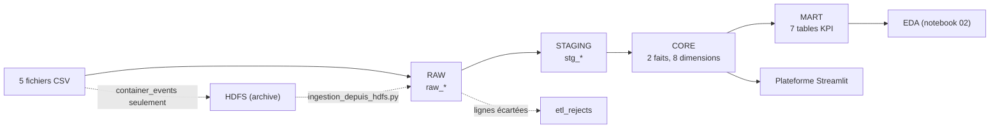
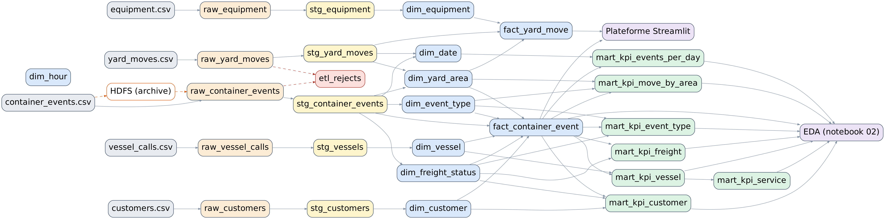

# 04 · Lineage : de la source à l'indicateur

Le lineage répond à : **d'où vient ce chiffre ?** et **que touche un changement de source ?**

## 1. Vue d'ensemble

Deux points à retenir :
- **Place de HDFS** : les notebooks chargent les CSV locaux. Le script `ingestion_depuis_hdfs.py` fait passer `container_events` par l'archive avant la couche RAW (testé en simulation, à exécuter sur le cluster). La preuve d'un chargement par ce chemin est `06_results/ingestion_hdfs_manifest.json`.
- **La plateforme calcule ses KPI depuis le CORE** (elle lit aussi les tables de qualité et de monitoring, et compte les lignes des autres couches). Le MART alimente l'EDA.

## 2. Schéma au niveau table (généré depuis le code de lineage)


`dim_hour` n'a pas de flèche entrante : elle est générée par le pipeline (24 heures). La plateforme joint aussi les dimensions aux faits.

## 3. Transformations par passage
| Passage | Transformation | Preuve de traçabilité |
|---|---|---|
| CSV → HDFS | copie, 3 réplicas | `fsck`, empreinte MD5 identique |
| CSV → RAW | copie en texte | `_source_file`, `_loaded_at` |
| RAW → STAGING | TRIM, typage, 15 règles, `Y08B` → `Y08` (colonne standardisée ajoutée) | `raw_rowid`, `etl_rejects`, `yard_area_raw` |
| STAGING → CORE | clés de substitution par jointure | `event_id`, `move_id` ; Q05, Q06, Q09–Q11 |
| CORE → MART | agrégations | Q12 et vérification des 7 tables (notebook 01, § 9.4) |

## 4. Lineage des KPI
| KPI | Colonnes CSV d'origine | Chemin principal |
|---|---|---|
| Événements par jour | `event_ts`, `event_id` | fait + `dim_date` → `mart_kpi_events_per_day` |
| MOVE par zone | `yard_area`, `event_type` (et zones de `yard_moves` pour la liste des zones) | fait + `dim_yard_area` → `mart_kpi_move_by_area` |
| Navire / service | `vessel_id`, `service_code`, `event_id`, `gross_weight_kg` | fait + `dim_vessel` → `mart_kpi_vessel` → `mart_kpi_service` |
| Activité par client | `customer_id` et attributs client | fait + `dim_customer` → `mart_kpi_customer` |
| Poids moyen par type | `event_type`, `gross_weight_kg` | fait + `dim_event_type` → `mart_kpi_event_type` |
| Part FCL / MTY | `freight_status`, `event_id` | fait + `dim_freight_status` → `mart_kpi_freight` |

## 5. Lineage au niveau colonne
[`lineage_colonnes.csv`](lineage_colonnes.csv) décrit **162 colonnes de 27 tables** (RAW, STAGING, CORE, MART) : origines directes, transformation, origines finales dans les CSV.

Exemple, `fact_container_event.area_key` :
`container_events.csv.yard_area` → `raw_container_events.yard_area` → `stg_container_events.yard_area_raw` → recherche dans `dim_yard_area` (dont les codes viennent aussi de `yard_moves.csv`) → `area_key`.

## 6. Analyse d'impact (exemple : `yard_area` change de codification)
`stg_container_events` → `dim_yard_area` → clés de zone des **deux** faits → `mart_kpi_move_by_area` → EDA et plateforme.

## 7. Tracer un chiffre
Le notebook `01_ETL_Pipeline/01_ETL_Pipeline.ipynb` (§ 9.3) suit l'événement 1 : CSV → RAW (ligne 1) → STAGING (`Y08B` standardisée en `Y08`) → fait → ligne du 25/03/2026 du MART.

## 8. Maintenir le lineage
```bash
cd 04_scripts/lineage
python lineage.py      # vérifie la description contre la base, puis régénère lineage_colonnes.csv
python diagramme.py    # régénère le schéma (nécessite Graphviz)
```
`lineage.py` échoue si une colonne apparaît ou disparaît, ou si une origine citée n'existe pas.

## 9. Limites
- La description est **écrite à la main** à partir du SQL ; la vérification porte sur les tables et les colonnes, **pas sur la justesse des formules**.
- Les tables techniques (`etl_*`) et les calculs internes de la plateforme et de l'EDA ne sont pas décrits colonne par colonne.
- Les faits ne portent ni `run_id` ni numéro de ligne RAW : une ligne acceptée se retrouve par sa clé métier, et l'historique des versions d'une donnée n'est pas conservé.
- Aucun outil de catalogue (OpenLineage, Apache Atlas, etc.) n'est utilisé.
