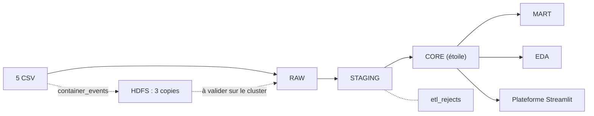
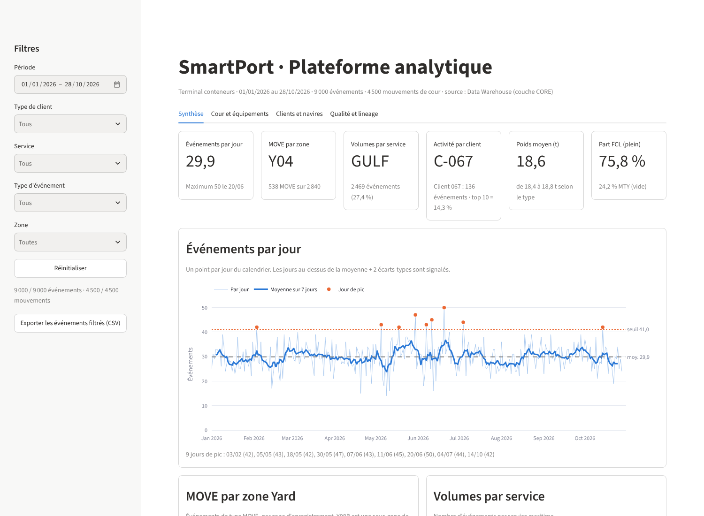

# SmartPort · Container Operations

**Plateforme analytique pour un terminal à conteneurs** : de 5 fichiers CSV à des indicateurs contrôlés et traçables.

Projet 01 · Master 2 IAMD · Gestion des données massives · Université de Djibouti
**Auteures :** Kadiga Ali Ahmed et Madina Ali Banoita

[Rapport](07_deliverables/rapport/rapport_smartport.pdf) · [Présentation](07_deliverables/presentation/SmartPort_presentation.pptx) · [Notebooks](#notebooks) · [Exécution](#installation-et-exécution) · [Gouvernance](05_governance/README.md)

## Objectif

Les données du terminal sont réparties dans cinq fichiers. Le projet les rassemble dans un Data Warehouse pour suivre six indicateurs :

| Indicateur | Résultat principal |
|---|---|
| Événements par jour | 29,9 en moyenne, 50 au maximum |
| MOVE par zone de la cour | Y04 en tête (538) selon la zone saisie ; Y08 (946) si Y08B y est rattachée |
| Volumes par navire et par service | GULF en tête : 27,4 % des événements |
| Activité par client | les 10 premiers clients font 14,3 % de l'activité |
| Poids moyen par type d'événement | de 18,4 t à 18,8 t |
| Part FCL / MTY (pleins / vides) | 75,8 % / 24,2 % |

> Les données sont **synthétiques** et de petit volume : le projet est une maquette. Les conteneurs vides et pleins ont des poids semblables, ce qui est incohérent. Le poids ne doit pas servir à estimer la charge réelle.

## Données

| Fichier | Contenu | Lignes |
|---|---|---:|
| `container_events.csv` | événements des conteneurs | 9 000 |
| `yard_moves.csv` | mouvements dans la cour | 4 500 |
| `vessel_calls.csv` | escales des navires | 120 |
| `customers.csv` | clients | 80 |
| `equipment.csv` | équipements | 40 |

Période des événements : du 1er janvier au 28 octobre 2026.

## Architecture



| Couche | Rôle |
|---|---|
| **RAW** | copie fidèle des 5 fichiers, en texte |
| **STAGING** | nettoyage, typage et 15 règles de rejet |
| **CORE** | schéma en étoile : 2 tables de faits et 8 dimensions |
| **MART** | 7 tables pour les indicateurs |

**Technologies :** Python, pandas, SQLite, SQL, Jupyter, Streamlit, Plotly, HDFS avec Docker.

## Qualité des données

| Mesure | Résultat |
|---|---|
| Chargement | 9 000 événements et 4 500 mouvements, 0 rejet |
| 32 contrôles | 30 `PASS`, 1 `WARN`, 1 `INFO`, 0 `FAIL` |
| Écart de réconciliation | 0 |
| Test avec des erreurs ajoutées | 13 lignes fausses rejetées sur 13 (12 règles sur 15 testées) |
| Lineage | 27 tables et 162 colonnes, sans écart de noms avec la base |

- `WARN` : 712 mouvements ont la même zone de départ et d'arrivée. Ils sont conservés et signalés.
- `INFO` : 1 481 événements de la sous-zone Y08B sont rattachés à Y08 dans la zone standardisée.

## Notebooks

| Sujet | Notebook |
|---|---|
| ETL | [01_ETL_Pipeline.ipynb](01_ETL_Pipeline/01_ETL_Pipeline.ipynb) |
| Analyse exploratoire (EDA) | [02_EDA_Analyse_Exploratoire.ipynb](02_EDA_Analyse_Exploratoire/02_EDA_Analyse_Exploratoire.ipynb) |
| Contrôle qualité | [controle_qualite.ipynb](04_scripts/etl/controle_qualite.ipynb) |
| Test des rejets | [test_rejets.ipynb](04_scripts/etl/test_rejets.ipynb) |
| Lineage | [lineage.ipynb](04_scripts/lineage/lineage.ipynb) |
| Page HTML de la plateforme | [build_plateforme.ipynb](04_scripts/platform/build_plateforme.ipynb) |
| Code de l'application Streamlit | [app_notebook.ipynb](04_scripts/platform/streamlit_app/app_notebook.ipynb) |
| Ingestion depuis HDFS | [ingestion_depuis_hdfs.ipynb](04_scripts/hdfs/ingestion_depuis_hdfs.ipynb) |

## Installation et exécution

Il faut Python 3.10 ou plus récent. Les commandes se lancent depuis la racine du projet.

```bash
git clone https://github.com/madina-ali09/SmartPort_container_operation.git
cd SmartPort_container_operation
python -m venv .venv
.venv\Scripts\activate           # Linux / macOS : source .venv/bin/activate
pip install -r requirements.txt
```

```bash
python 04_scripts/etl/etl_pipeline.py     # 1. construire le Data Warehouse
python 04_scripts/etl/test_rejets.py      # 2. tester les règles de rejet
python 04_scripts/eda/eda_smartport.py    # 3. produire les graphiques
python 04_scripts/lineage/lineage.py      # 4. vérifier le lineage
streamlit run 04_scripts/platform/streamlit_app/app.py   # 5. ouvrir la plateforme
```

Pour les notebooks, lancez `jupyter lab`, puis *Run All*. Une version de la plateforme sans serveur se trouve dans `04_scripts/platform/smartport_plateforme.html` (à télécharger puis ouvrir dans un navigateur).

Les requêtes SQL sont dans `04_scripts/sql/` : `exploration/` pour l'analyse et `pipeline/` pour le pipeline en SQL.

## Aperçu de la plateforme



## HDFS

Le cluster Docker comprend 1 NameNode et 3 DataNodes, avec une réplication de 3. Voir le [guide HDFS](04_scripts/hdfs/README_HDFS_Docker.md).

- **Réalisé :** l'archivage de `container_events.csv` sur le cluster avec PowerShell, avec vérification de l'empreinte MD5 ([captures](06_results/hdfs_captures/)).
- **À valider :** le chargement du Data Warehouse depuis HDFS (`ingestion_depuis_hdfs.py`), testé seulement avec des commandes simulées.

## Structure du projet

```
├── 00_brief/                        sujet et consignes
├── 01_ETL_Pipeline/                 notebook ETL
├── 02_EDA_Analyse_Exploratoire/     notebook d'analyse
├── 03_data/                         CSV, dictionnaires, bases SQLite
├── 04_scripts/                      Python, SQL, HDFS, plateforme
├── 05_governance/                   gouvernance et lineage
├── 06_results/                      figures et captures
├── 07_deliverables/                 rapport et présentation
├── archive/                         ancien notebook, fichiers de l'enseignant
└── requirements.txt
```

## Gouvernance et limites

La [documentation de gouvernance](05_governance/README.md) couvre les rôles, la classification et les accès, la qualité, le lineage, les métadonnées et le suivi.

**Limites :**
- reconstruction complète de la base à chaque exécution ;
- HDFS sur une seule machine ;
- règles d'accès proposées, mais non appliquées ;
- plateforme sans authentification.
