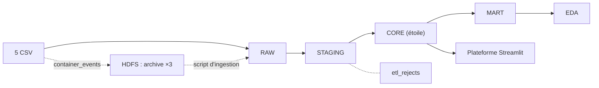

# SmartPort · Container Operations

Plateforme analytique d'un terminal à conteneurs : de 5 fichiers CSV à des indicateurs de pilotage contrôlés et traçables.
Master 2 IAMD · Gestion des données massives · Projet 01 · Kadiga Ali Ahmed, Madina Ali Banoita.

> Données synthétiques et de petit volume : le projet est une **maquette**.

## Architecture

| Couche | Contenu |
|---|---|
| RAW | 5 tables, copie fidèle en texte |
| STAGING | nettoyage, typage, 15 règles de rejet |
| CORE | `fact_container_event`, `fact_yard_move`, 8 dimensions |
| MART | 7 tables pour 6 KPI |
| Transverse | 32 contrôles, réconciliation, monitoring, lineage, gouvernance |

**Deux modes de chargement.** Les notebooks lisent les CSV locaux. `04_scripts/hdfs/ingestion_depuis_hdfs.py` archive d'abord `container_events.csv` dans HDFS, vérifie l'empreinte MD5 de la copie relue, puis la charge (testé en simulation, à exécuter sur le cluster).

## Arborescence
```
SmartPort_Projet01/
├── README.md
├── requirements.txt
├── 00_brief/                        sujet et consignes
├── 01_ETL_Pipeline/
│   └── 01_ETL_Pipeline.ipynb               ETL commenté, interprété, lineage
├── 02_EDA_Analyse_Exploratoire/
│   └── 02_EDA_Analyse_Exploratoire.ipynb   statistiques, graphiques, conclusions
├── 03_data/
│   ├── raw/                         5 CSV (ne pas modifier)
│   ├── dictionary/                  dictionnaires enrichis et catalogue des KPI
│   └── warehouse/                   bases SQLite
├── 04_scripts/
│   ├── etl/                         pipeline Python et test des rejets
│   ├── eda/                         script des 7 graphiques
│   ├── lineage/                     vérification et schéma du lineage
│   ├── sql/exploration/             18 requêtes d'exploration
│   ├── sql/pipeline/                pipeline en SQL pur
│   ├── hdfs/                        cluster Docker
│   └── platform/                    application Streamlit et page HTML
├── 05_governance/                   documentation par thème
├── 06_results/                      figures, captures HDFS et plateforme
├── 07_deliverables/                 rapport et présentation
└── 99_archive/                      versions antérieures, fichiers de l'enseignant
```

## Installation
**Prérequis :**
- [Python](https://www.python.org/downloads/) 3.10 ou plus récent ;
- [Git](https://git-scm.com), pour cloner le projet ;
- [Docker Desktop](https://www.docker.com/products/docker-desktop/), seulement pour la partie HDFS ;
- Graphviz, facultatif, seulement pour régénérer le schéma du lineage.

**1. Cloner le projet**
```bash
git clone https://github.com/madina-ali09/SmartPort_container_operation.git
cd SmartPort_container_operation
```

**2. Créer l'environnement virtuel**
```bash
python -m venv .venv
```

**3. Activer l'environnement**

Windows (PowerShell) :
```powershell
.venv\Scripts\Activate.ps1
```
Linux / macOS :
```bash
source .venv/bin/activate
```
Si PowerShell bloque l'activation, lancer `Set-ExecutionPolicy -Scope Process -ExecutionPolicy RemoteSigned`, puis recommencer. Ce réglage ne vaut que pour la fenêtre ouverte.

**4. Installer les bibliothèques**
```bash
python -m pip install -r requirements.txt
```

## Exécution
**1. Notebooks (dans cet ordre)** : `jupyter lab`, puis *Run All* sur `01_ETL_Pipeline/01_ETL_Pipeline.ipynb`, puis sur `02_EDA_Analyse_Exploratoire/02_EDA_Analyse_Exploratoire.ipynb`.

En ligne de commande :
```bash
jupyter nbconvert --to notebook --execute --inplace 01_ETL_Pipeline/01_ETL_Pipeline.ipynb
jupyter nbconvert --to notebook --execute --inplace 02_EDA_Analyse_Exploratoire/02_EDA_Analyse_Exploratoire.ipynb
```
**2. Ou les scripts** (même pipeline, sans Jupyter) :
```bash
python 04_scripts/etl/etl_pipeline.py     # construit l'entrepôt
python 04_scripts/etl/test_rejets.py      # prouve les règles de rejet
python 04_scripts/eda/eda_smartport.py    # régénère les 7 graphiques
python 04_scripts/lineage/lineage.py      # vérifie le lineage
python 04_scripts/lineage/diagramme.py    # schéma (Graphviz requis)
```
**3. Plateforme** (après l'ETL) :
```bash
streamlit run 04_scripts/platform/streamlit_app/app.py
```
Version sans serveur : ouvrir `04_scripts/platform/smartport_plateforme.html` (la régénérer avec `python 04_scripts/platform/build_plateforme.py`).

**4. SQL dans DB Browser for SQLite** : ouvrir `03_data/warehouse/smartport_sources.db` pour `04_scripts/sql/exploration/` ; pour le pipeline en SQL pur, suivre les prérequis en tête de `04_scripts/sql/pipeline/00_PIPELINE_COMPLET.sql` (sur une copie de la base).

**5. HDFS** : démarrer le cluster (voir `04_scripts/hdfs/README_HDFS_Docker.md`), puis `python 04_scripts/hdfs/ingestion_depuis_hdfs.py`.

**Le code Python en notebooks.** Chaque traitement a sa version notebook. Les fichiers `.py` sont gardés : certains appellent ou importent `etl_pipeline.py`.

| Sujet | Notebook | Script |
|---|---|---|
| ETL | [`01_ETL_Pipeline.ipynb`](01_ETL_Pipeline/01_ETL_Pipeline.ipynb) | `etl_pipeline.py` |
| EDA | [`02_EDA_Analyse_Exploratoire.ipynb`](02_EDA_Analyse_Exploratoire/02_EDA_Analyse_Exploratoire.ipynb) | `eda_smartport.py` |
| Contrôle qualité | [`controle_qualite.ipynb`](04_scripts/etl/controle_qualite.ipynb) | contrôles produits par l'ETL |
| Test des rejets | [`test_rejets.ipynb`](04_scripts/etl/test_rejets.ipynb) | `test_rejets.py` |
| Lineage | [`lineage.ipynb`](04_scripts/lineage/lineage.ipynb) | `lineage.py` + `diagramme.py` |
| Plateforme HTML | [`build_plateforme.ipynb`](04_scripts/platform/build_plateforme.ipynb) | `build_plateforme.py` |
| Ingestion HDFS | [`ingestion_depuis_hdfs.ipynb`](04_scripts/hdfs/ingestion_depuis_hdfs.ipynb) (cluster démarré requis ; sans résultats enregistrés) | `ingestion_depuis_hdfs.py` |
| Streamlit | [`app_notebook.ipynb`](04_scripts/platform/streamlit_app/app_notebook.ipynb) : écrit `app_notebook.py`, à lancer avec `streamlit run` | `app.py` |

> Le code ETL existe dans le notebook 01 et dans `etl_pipeline.py` : toute modification d'une règle doit être reportée dans les deux, ainsi que dans le SQL pur.

## Résultats attendus
| Mesure | Valeur |
|---|---|
| Événements / mouvements chargés | 9 000 / 4 500 |
| Lignes rejetées | 0 (13 sur 13 lors du test d'injection) |
| Contrôles | 30 PASS, 1 WARN, 1 INFO, 0 FAIL |
| Événements par jour | 29,9 en moyenne |
| Première zone MOVE | Y04 (538) |
| Premier service | GULF (27,4 %) |
| Part FCL | 75,8 % |
| Lineage vérifié | 27 tables, 162 colonnes |

## Documentation et livrables
- Conformité aux consignes et reste à faire : [`CONFORMITE_CONSIGNES.md`](CONFORMITE_CONSIGNES.md)
- Schéma d'architecture : `06_results/figures/architecture_finale.png`
- Gouvernance : [`05_governance/README.md`](05_governance/README.md), dont le [lineage](05_governance/04_lineage.md)
- Rapport : `07_deliverables/rapport/`
- Présentation et notes orales : `07_deliverables/presentation/`

## Limites
Données synthétiques ; reconstruction complète à chaque exécution ; HDFS sur une seule machine ; ingestion via HDFS à valider sur le cluster ; règles d'accès proposées mais non appliquées ; plateforme sans authentification.
